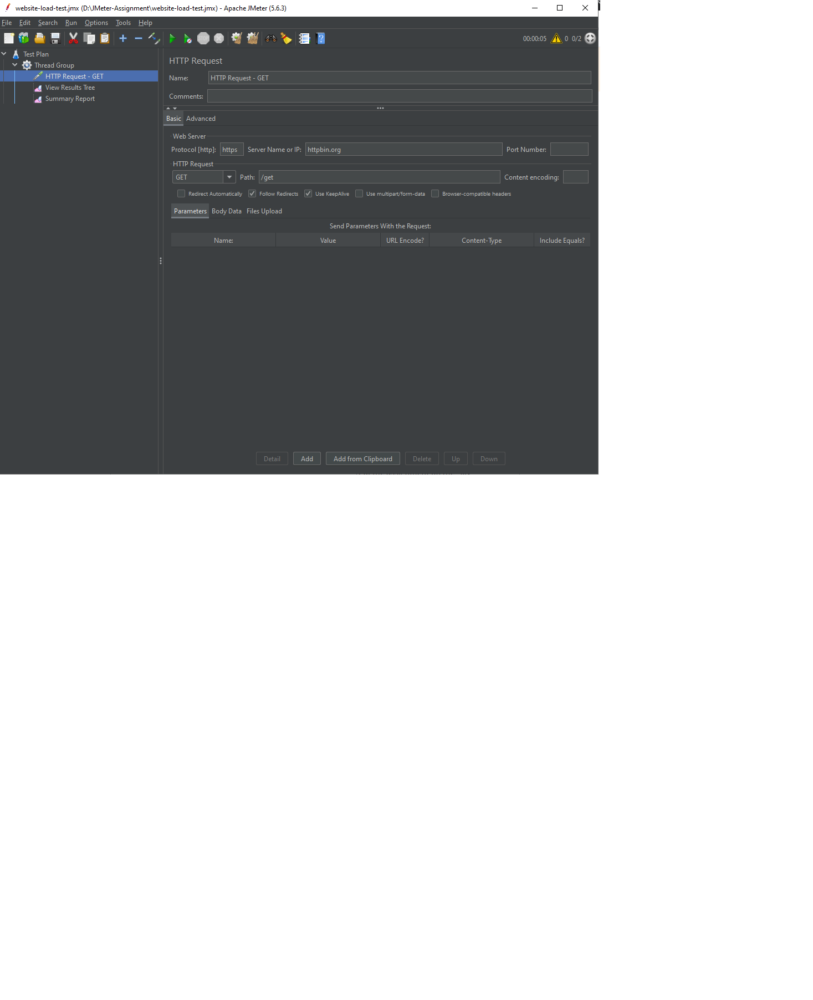
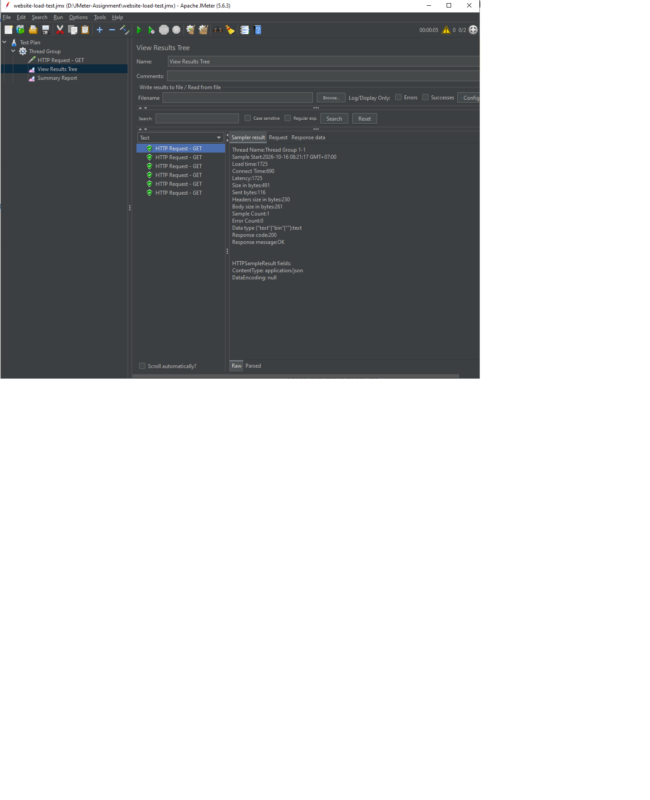
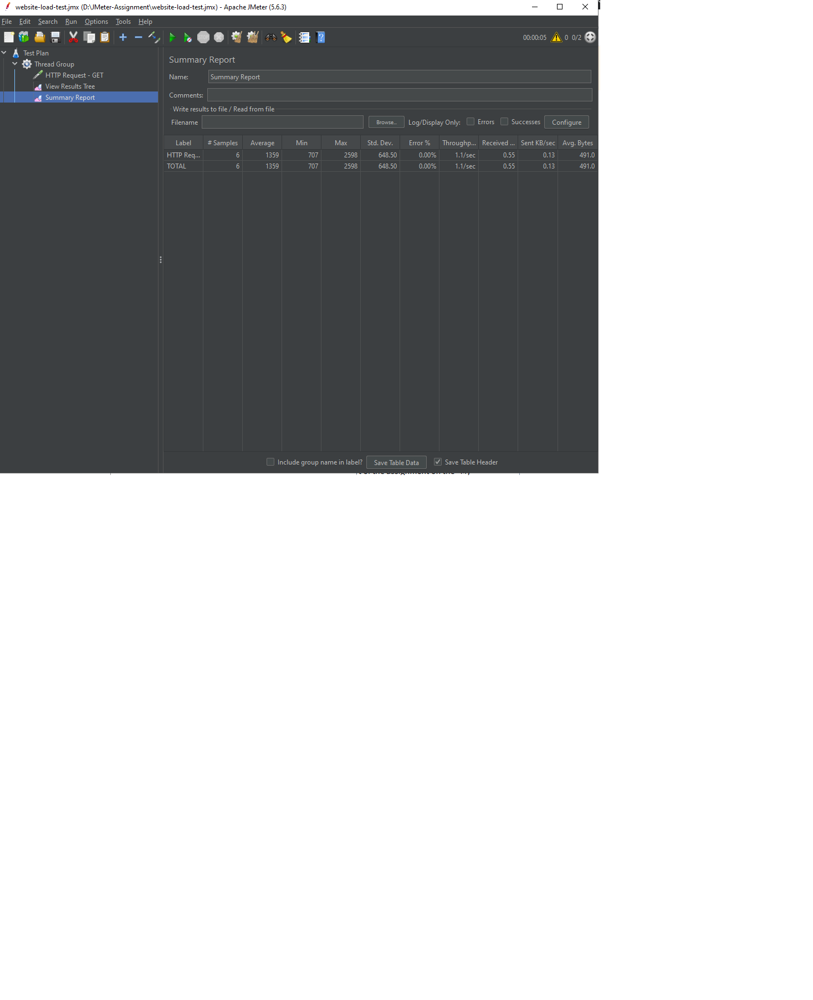

# BÁO CÁO THỰC HÀNH APACHE JMETER

## 1. Giới thiệu

### 1.1. Tổng quan

Apache JMeter là công cụ mã nguồn mở dùng để kiểm thử hiệu năng, kiểm thử tải và đánh giá khả năng phản hồi của ứng dụng web, API và dịch vụ mạng. Công cụ cho phép mô phỏng người dùng gửi yêu cầu đến hệ thống, thu thập số liệu và phân tích kết quả.

Trong bài thực hành này, em sử dụng Apache JMeter để kiểm thử HTTP GET đến dịch vụ thử nghiệm `https://httpbin.org/get`. Qua đó, em tìm hiểu cách tạo Test Plan, cấu hình Thread Group, thiết lập HTTP Request, sử dụng Listener và phân tích các chỉ số hiệu năng cơ bản.

### 1.2. Mục tiêu

- Làm quen với giao diện và các thành phần cơ bản của Apache JMeter.
- Xây dựng kịch bản kiểm thử HTTP bằng Test Plan.
- Cấu hình người dùng ảo, thời gian khởi tạo và số vòng lặp.
- Gửi yêu cầu HTTP GET đến endpoint thử nghiệm.
- Theo dõi từng yêu cầu bằng View Results Tree.
- Tổng hợp số liệu bằng Summary Report.
- Phân tích thời gian phản hồi, tỷ lệ lỗi và thông lượng.
- Lưu kịch bản, hình ảnh minh chứng và báo cáo trên GitHub.

## 2. Môi trường kiểm thử

| Thành phần | Thông tin |
|---|---|
| Công cụ kiểm thử | Apache JMeter 5.6.3 |
| Hệ điều hành | Microsoft Windows 10 |
| Môi trường chạy | Máy tính cá nhân |
| Giao thức | HTTPS |
| Phương thức HTTP | GET |
| Đối tượng kiểm thử | [`https://httpbin.org/get`](https://httpbin.org/get) |
| Định dạng phản hồi dự kiến | JSON |
| File kịch bản | `website-load-test.jmx` |

`httpbin.org` là dịch vụ công khai hỗ trợ kiểm tra các yêu cầu HTTP. Endpoint `/get` trả về dữ liệu mô tả yêu cầu nhận được, phù hợp để thực hành gửi GET request và quan sát phản hồi. Kết quả có thể thay đổi theo thời điểm, tình trạng dịch vụ và điều kiện mạng.

## 3. Đối tượng và phạm vi kiểm thử

### 3.1. Đối tượng kiểm thử

Đối tượng được kiểm thử là endpoint `https://httpbin.org/get`. Endpoint này nhận yêu cầu HTTP GET và trả về thông tin của yêu cầu dưới dạng JSON.

### 3.2. Phạm vi kiểm thử

Bài thực hành tập trung vào khả năng gửi GET request, nhận phản hồi, mã trạng thái HTTP, thời gian phản hồi, số lượng yêu cầu, số yêu cầu thành công/thất bại và thông lượng xử lý. Bài thực hành chưa đánh giá khả năng chịu tải cực đại, tài nguyên CPU/RAM phía máy chủ hoặc hiệu năng toàn bộ một website thực tế.

## 4. Kịch bản kiểm thử

### 4.1. Cấu hình Thread Group

Thread Group xác định số lượng người dùng ảo và số lần thực hiện yêu cầu.

| Thông số | Giá trị |
|---|---:|
| Number of Threads (users) | 2 |
| Ramp-up Period | 1 giây |
| Loop Count | 3 |
| Số HTTP Request mỗi vòng lặp | 1 |
| Tổng số yêu cầu dự kiến | 6 |

**Công thức:** Tổng số yêu cầu = Số người dùng ảo × Số vòng lặp × Số request mỗi vòng lặp.

Theo cấu hình trên: `2 × 3 × 1 = 6` yêu cầu. Hai người dùng ảo được khởi tạo trong khoảng ramp-up 1 giây; mỗi người dùng thực hiện ba vòng lặp, mỗi vòng gửi một GET request.

**Lưu ý:** Đây là cấu hình tải thấp để xác minh cách sử dụng JMeter và kiểm tra phản hồi endpoint, không tương đương kịch bản 100 người dùng trong 60 giây.

### 4.2. Cấu hình HTTP Request

| Thông số | Giá trị |
|---|---|
| Name | HTTP Request - GET |
| Protocol | `https` |
| Server Name or IP | `httpbin.org` |
| Method | `GET` |
| Path | `/get` |
| Content encoding | Để mặc định nếu không cần chỉ định riêng |

Yêu cầu được gửi đến `https://httpbin.org/get`. GET được dùng để lấy dữ liệu từ endpoint. Vì yêu cầu không gửi dữ liệu trong phần thân request nên không cần cấu hình Body Data.

### 4.3. Các Listener sử dụng

**View Results Tree:** Cho phép quan sát từng yêu cầu, thời gian phản hồi, mã trạng thái HTTP, thông báo phản hồi, nội dung trả về và thông tin lỗi nếu có. Listener này hỗ trợ xác định mẫu thành công hoặc thất bại.

**Summary Report:** Tổng hợp số mẫu, thời gian phản hồi trung bình, nhỏ nhất/lớn nhất, độ lệch chuẩn, tỷ lệ lỗi, thông lượng và lưu lượng dữ liệu nhận/gửi.

## 5. Quy trình thực hiện

1. **Khởi tạo Test Plan:** Mở Apache JMeter 5.6.3 và tạo Test Plan để quản lý kịch bản.
2. **Thêm Thread Group:** Đặt số người dùng ảo là 2, Ramp-up Period là 1 giây và Loop Count là 3.
3. **Thêm HTTP Request:** Cấu hình HTTPS, máy chủ `httpbin.org`, phương thức GET và đường dẫn `/get`.
4. **Thêm Listener:** Thêm View Results Tree và Summary Report.
5. **Lưu kịch bản:** Lưu Test Plan thành `website-load-test.jmx`.
6. **Chạy kiểm thử:** Nhấn Start, sau khi hoàn thành kiểm tra View Results Tree và Summary Report.
7. **Phân tích kết quả:** Ghi lại số liệu Summary Report, đối chiếu số mẫu thực tế với số dự kiến và kiểm tra các mẫu lỗi.

## 6. Kết quả kiểm thử

Lần chạy được lựa chọn để báo cáo có 6 yêu cầu HTTP GET. Các chỉ số được ghi nhận từ Summary Report:

| Chỉ số | Kết quả |
|---|---:|
| Tổng số yêu cầu (Samples) | 6 |
| Thời gian phản hồi trung bình (Average) | 1.359 ms (1,359 giây) |
| Thời gian phản hồi nhỏ nhất (Min) | 707 ms |
| Thời gian phản hồi lớn nhất (Max) | 2.598 ms (2,598 giây) |
| Độ lệch chuẩn (Std. Dev.) | 648,50 ms |
| Tỷ lệ lỗi (Error %) | 0,00% |
| Throughput | Khoảng 1,1 yêu cầu/giây |

Số liệu trên được lấy từ lần chạy có 6 Samples và Error 0,00%. Những lần chạy trước có số lượng yêu cầu hoặc tỷ lệ lỗi khác không không được sử dụng làm kết quả chính.

### 6.1. Số lượng yêu cầu thành công

JMeter ghi nhận 6 yêu cầu và tỷ lệ lỗi 0,00% trong lần chạy được chọn.

- Số yêu cầu không lỗi: 6.
- Số yêu cầu lỗi: 0.
- Tỷ lệ không lỗi: `6/6 × 100% = 100%`.
- Tỷ lệ lỗi: `0/6 × 100% = 0%`.

Điều này cho thấy các yêu cầu được JMeter ghi nhận là không lỗi trong lần chạy này. Kết quả với mẫu nhỏ không đảm bảo dịch vụ sẽ không lỗi khi tải cao hơn.

### 6.2. Thời gian phản hồi trung bình

Average là 1.359 ms, tương đương khoảng 1,359 giây. Chỉ số này thể hiện thời gian phản hồi trung bình của các yêu cầu trong lần kiểm thử. Thời gian có thể thay đổi theo tình trạng dịch vụ, độ trễ mạng và điều kiện kết nối. Không nên chỉ dựa vào một lần chạy nhỏ để kết luận hiệu năng tổng thể của máy chủ.

### 6.3. Thời gian phản hồi nhỏ nhất và lớn nhất

- Min: 707 ms.
- Max: 2.598 ms.

Chênh lệch giữa Min và Max cho thấy thời gian phản hồi không giống nhau ở mọi mẫu. Nguyên nhân có thể liên quan đến độ trễ mạng, thời gian xử lý phía dịch vụ hoặc các yếu tố môi trường.

### 6.4. Độ lệch chuẩn

Std. Dev. là 648,50 ms, thể hiện mức độ phân tán của thời gian phản hồi so với giá trị trung bình. Do chỉ có 6 mẫu, cần thận trọng khi dùng chỉ số này để đánh giá tính ổn định lâu dài.

### 6.5. Thông lượng xử lý (Throughput)

Throughput được ghi nhận khoảng 1,1 yêu cầu/giây. Thông lượng là tốc độ xử lý yêu cầu quan sát được trong khoảng thời gian kiểm thử và chịu ảnh hưởng của thời gian phản hồi, thời gian chạy, số người dùng ảo và điều kiện kết nối. Với chỉ 6 yêu cầu, không thể dùng giá trị này để khẳng định giới hạn xử lý tối đa của endpoint.

### 6.6. Tổng hợp kết quả

| Tiêu chí | Nhận xét |
|---|---|
| Hoàn thành kịch bản | Đã ghi nhận đủ 6 yêu cầu |
| Tỷ lệ lỗi | 0% trong lần chạy được chọn |
| Thời gian phản hồi | Trung bình 1.359 ms |
| Độ biến động | Có chênh lệch giữa Min và Max |
| Thông lượng | Khoảng 1,1 yêu cầu/giây |
| Mức độ đánh giá | Kiểm thử cơ bản, tải thấp |

## 7. Hình ảnh minh chứng

Các ảnh minh họa cấu hình và kết quả thực tế được lưu trong thư mục `screenshots` ở thư mục gốc repository.

### 7.1. Cấu hình Thread Group

Hình ảnh thể hiện số người dùng ảo, Ramp-up Period và số vòng lặp được thiết lập cho kịch bản kiểm thử.


### 7.2. Cấu hình HTTP Request

Hình ảnh thể hiện giao thức HTTPS, máy chủ `httpbin.org`, phương thức GET và đường dẫn `/get`.



### 7.3. Kết quả từng yêu cầu

View Results Tree minh họa thời gian phản hồi, mã trạng thái HTTP và thông tin phản hồi của từng yêu cầu.



### 7.4. Summary Report

Summary Report thể hiện tổng số mẫu, thời gian phản hồi trung bình, Min, Max, độ lệch chuẩn, tỷ lệ lỗi và Throughput.



### 7.5. Tổng quan Test Plan

Hình ảnh thể hiện cấu trúc Test Plan gồm Thread Group, HTTP Request và các Listener được sử dụng trong bài thực hành.


## 8. Đánh giá và hạn chế

### 8.1. Đánh giá

Trong lần chạy được lựa chọn, kịch bản đã thực hiện đủ 6 yêu cầu HTTP GET và không ghi nhận lỗi. Kết quả cho thấy cấu hình cơ bản của JMeter hoạt động và có thể thu thập các chỉ số cần thiết. Bài thực hành giúp làm quen với quá trình xây dựng kịch bản, xem kết quả chi tiết và đọc báo cáo tổng hợp.

### 8.2. Hạn chế

- Số lượng yêu cầu còn ít, chỉ có 6 mẫu.
- Chưa thực hiện kiểm thử tải liên tục trong 60 giây.
- Chưa mô phỏng 100 người dùng đồng thời.
- Chưa đánh giá khả năng chịu tải cực đại hoặc hành vi khi tải tăng cao.
- Chưa đo CPU, bộ nhớ và tài nguyên phía máy chủ.
- Kết quả phụ thuộc vào dịch vụ công khai và điều kiện mạng tại thời điểm kiểm thử.

Do đó, kết quả phù hợp với mục đích học tập và làm quen công cụ hơn là đánh giá hiệu năng toàn diện.

## 9. Kết luận

Qua bài thực hành, em đã sử dụng Apache JMeter 5.6.3 để xây dựng và thực hiện kịch bản kiểm thử HTTP GET đến endpoint `https://httpbin.org/get`.

Kịch bản được cấu hình với 2 người dùng ảo, Ramp-up Period 1 giây và 3 vòng lặp. Kết quả ghi nhận 6 yêu cầu, tỷ lệ lỗi 0,00%, thời gian phản hồi trung bình 1.359 ms và Throughput khoảng 1,1 yêu cầu/giây.

Các yêu cầu được JMeter ghi nhận là không lỗi trong lần chạy được chọn. Tuy nhiên, do số lượng yêu cầu ít và tải thử nghiệm thấp, chưa đủ cơ sở để kết luận về khả năng chịu tải hoặc hiệu năng tối đa của dịch vụ.

Qua đó, em đã hiểu quy trình tạo Test Plan, cấu hình Thread Group, gửi HTTP Request, theo dõi kết quả và phân tích các chỉ số hiệu năng cơ bản trong Apache JMeter.

## 10. Cấu trúc repository

```text
jmeter-load-testing/
├── README.md
├── website-load-test.jmx
└── screenshots/
    ├── 01-thread-group.png
    ├── 02-http-request.png
    ├── 03-test-results.png
    ├── 04-summary-report.png
    └── 05-test-plan-overview.png
```

## 11. Tài liệu tham khảo

- Apache JMeter – Website chính thức: [https://jmeter.apache.org/](https://jmeter.apache.org/)
- Apache JMeter – User Manual: [https://jmeter.apache.org/usermanual/](https://jmeter.apache.org/usermanual/)
- HTTPBin – HTTP Request & Response Testing: [https://httpbin.org/](https://httpbin.org/)
